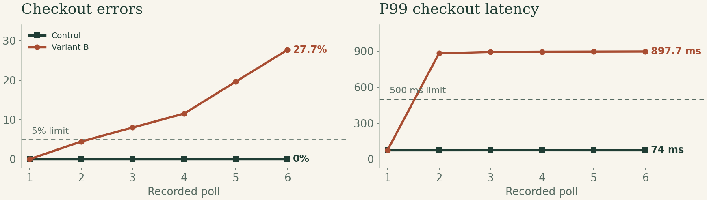
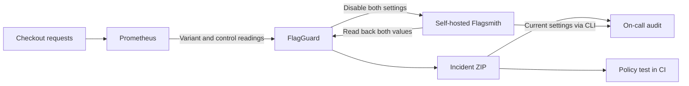
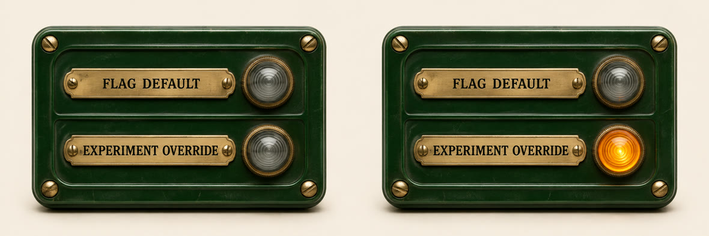
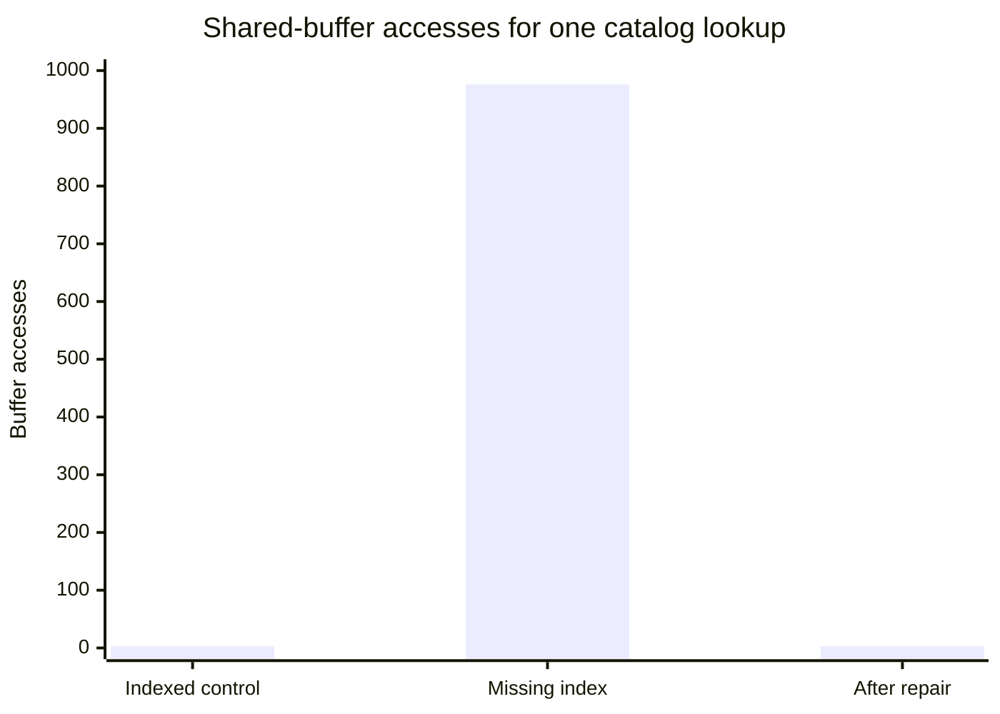

# FlagGuard

**Roll back a failing experiment in self-hosted Flagsmith. Keep the evidence so the next engineer can check what happened.**


A checkout experiment starts timing out. The original checkout is still fast. FlagGuard watches both versions in Prometheus, waits for a sustained breach, then disables the environment flag and its experiment override. The on-call engineer gets the readings that triggered the switch and a test they can run against the next policy change.

| Try FlagGuard | What you can verify |
| --- | --- |
| **Track 3 · Self-hosted integration** | Break one checkout version, watch FlagGuard switch traffic back, then replay the decision. [Run the checkout lab](#run-the-checkout-lab) · [Inspect six recorded polls](#six-polls-from-a-checkout-incident) |
| **Track 4 · Agent Skill** | Check a flag and its experiment override with the Flagsmith CLI. Add an incident ZIP to check whether a recorded reset explains a reopened rollout. [Try the read-only audit](#the-next-shift) · [Open the skill](skills/audit-flagsmith-rollback/SKILL.md) |

## Six polls from a checkout incident

The experimental checkout crossed its 5% error limit on poll three. Fifteen seconds later, **27.7% of requests to Variant B were failing**. Control had zero errors. By then, p99 latency on the experimental checkout had risen from 75 ms to 898 ms. These are the six measurements saved by the controller during a synthetic run on Ubuntu. [Original trace](docs/evidence/ubuntu-checkout/trace.json) · [Rollback decision](docs/evidence/ubuntu-checkout/decision.json)



<details>
<summary>Inspect the six readings</summary>

| Poll | Variant B errors | Control errors | Variant B p99 | Control p99 |
| ---: | ---: | ---: | ---: | ---: |
| 1 | 0.0% | 0% | 75 ms | 74 ms |
| 2 | 4.4% | 0% | 883 ms | 74 ms |
| 3 | 8.0% | 0% | 894 ms | 74 ms |
| 4 | 11.5% | 0% | 896 ms | 74 ms |
| 5 | 19.6% | 0% | 897 ms | 74 ms |
| 6 | 27.7% | 0% | 898 ms | 74 ms |

</details>

**Replay it from a clone with Go and Make.** The Linux case runs offline once Go dependencies are available.

```sh
make replay-ubuntu
```

The first check asks whether checkout was protected by poll six. The second asks which rule fired. Change the error confirmation from 15 seconds to one minute and latency fires instead. The deadline still passes, while the rule check catches the difference. Both checks work in a pull request with the included [GitHub Action](action.yml). [Try the policy change](docs/POLICY_REPLAY.md#compare-the-trigger-and-the-deadline)

## Run the checkout lab

Install Docker with Compose, Python 3 and Make. The first run downloads images and migrates the Flagsmith database. The lab uses local ports 8000, 8081, 8085 and 9090. [Setup without Make](docs/FRESH_MACHINE.md#without-make)

```sh
git clone https://github.com/Rishabh1925/FlagGuard.git
cd FlagGuard
make demo
```

1. Open the [local workspace](http://localhost:8085/workspace). Wait for **Healthy**, then select **Inject fault into Variant B**.
2. Watch errors and p99 latency alongside control. The checkout policy requires 20 estimated requests in the measurement window and 15 seconds of sustained breach.
3. Open **Incident history**. Inspect the two Flagsmith settings and download the regression test.
4. Select **Review recovery**. After reset, the controller waits for fresh traffic before declaring checkout healthy.


For an automated run, use `python3 scripts/smoke.py`. It makes 20 fresh checkout requests after rollback and verifies that they succeed on control. In the final November 28 handoff trial, the switch was verified in **42.1 seconds** and **20/20 checkouts succeeded**. Use `make down` to stop the stack while keeping its data. [Trial receipt](docs/evidence/recovery-handoff.json) · [Setup and troubleshooting](docs/FRESH_MACHINE.md)



## The next shift

A disabled environment flag can still have an enabled experiment override. The left panel shows both off. The right shows the override reopened. An operator looking at the top light alone would miss it.



Give the [rollback audit skill](skills/audit-flagsmith-rollback/SKILL.md) the incident ZIP and the intended environment. It reads the two current settings with the official Flagsmith CLI, replays the decision and checks the retained journal for a matching reset. A reset can explain why the settings changed. A fresh application request tells you what customers actually receive.

| Finding | What the next shift can establish |
| --- | --- |
| Both settings off, replay matched | Flagsmith still has the recorded rollback configuration. |
| Settings reopened, matching reset | The settings match a verified recovery in this incident’s history. |
| Override on, no matching reset | Check the change record before treating this as an expected recovery. |
| Trace missing, override on | The override is enabled. Historical replay is unavailable. |

Have an existing Flagsmith experiment? The skill can check its two live settings using Python and the official CLI alone. On the self-hosted checkout lab, the two API responses came to 485 tokens and the agent received a 28-token summary. [Live receipt](docs/evidence/standalone-audit.json) · [Run it without FlagGuard](docs/ROLLBACK_SKILL.md#check-an-experiment-without-a-flagguard-installation)

**Try the skill without an account.** With Python 3 and the official Flagsmith CLI v2 on PATH, run this from the clone.

```sh
python3 scripts/rehearse-rollback-skill.py --scenario live-override
```

The fixture turns the experiment override on while the default is off. Look for `"default_enabled":false`, `"rollout_enabled":true` and `"verdict":"SETTING_ENABLED"` in the result.

**Replay the recovery shown in the demo.** This also needs Go.

```sh
go build -o bin/flagguard ./cmd/flagguard
export PATH="$PWD/bin:$PATH"
python3 scripts/rehearse-rollback-skill.py --scenario recovered
```

The rehearsal uses simulated current settings and real recorded Linux polls. An optional on-device runner completed the recovery handoff with **841 input tokens and 20 output tokens**. The full coding-agent run used substantially more. [Skill setup, all 20 scenarios and measured token usage](docs/ROLLBACK_SKILL.md)

## Two failures a status code misses

| Service | What broke | What the replay showed |
| --- | --- | --- |
| Pricing API | Both versions returned HTTP 200. The candidate renamed the field the client needed. | The tuned policy tolerated one bad response and caught a sustained break five seconds later than the original rule. [Run the price cases](deploy/blackbox/README.md) |
| PostgreSQL catalog | Both queries returned the right item. The candidate lost its index. | The candidate used 976 shared-buffer accesses against 3 on control. After the index repair, both used 3. [Run the database cases](deploy/postgres/README.md) |

<details>
<summary>Compare database work per lookup</summary>



Measured on the same 40,000-row PostgreSQL fixture. [Queries and recorded cases](deploy/postgres/README.md)

</details>

Once the price flag was off, a direct probe still exercised the candidate. FlagGuard refused an early reset. After the repair, four probes passed, an operator reopened the rollout and five fresh reads returned the correct price. [Recovery record](docs/evidence/price-recovery.json)

## Bring your own service

Start in shadow mode to review proposed rollbacks against your traffic. Configure the flag, experiment, measurements and limits in the guardrail policy. Run the Go controller alongside your self-hosted Flagsmith and Prometheus instances. [Example policy](guardrails.yaml) · [Operations guide](docs/OPERATIONS.md) · [Standalone Compose](compose.standalone.yml)

[Policy replay guide](docs/POLICY_REPLAY.md) · [Verification records](docs/VERIFICATION.md) · [MIT license](LICENSE)
