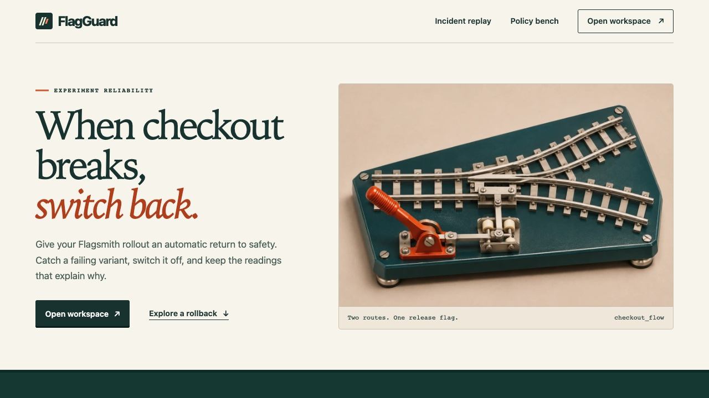
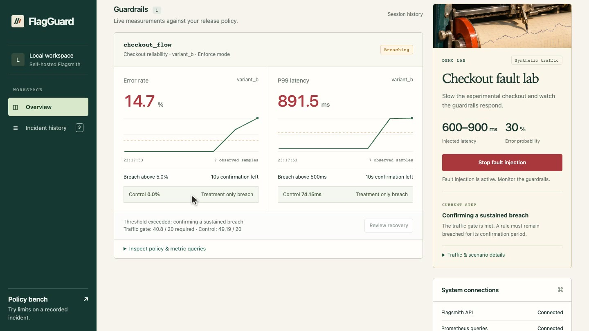

# FlagGuard

FlagGuard rolls back failing feature releases in self-hosted Flagsmith. It watches the experimental version in Prometheus, waits for a sustained breach, then disables the rollout and reads the settings back. Each incident keeps the measurements that led to the decision.

[Run the checkout lab](#run-the-checkout-lab) · [Replay an incident](#replay-an-incident) · [Connect your application](docs/OPERATIONS.md#configure-an-existing-stack)



## One checkout incident

In this recorded run, the experimental checkout started failing while the original stayed healthy. Flagsmith had two settings in play: the environment flag and the active experiment's rollout override. FlagGuard switched off both. The smoke test then made fresh checkout requests to check what the application actually served.

| From fault injection to verified rollback | Flagsmith settings read back | Successful follow-up checkouts |
| --- | --- | --- |
| **39.6 seconds** | **Both disabled** | **20 of 20 on control** |

The requests came from the local traffic generator. You can inspect the timestamped readings, flag changes and request results in the [checkout incident record](internal/server/static/exhibit/checkout.json).

## Run the checkout lab

Install Docker with Compose, Python 3 and Make. The lab uses ports `8000`, `8081`, `8085` and `9090`. The first start downloads images and runs the Flagsmith database migrations.

```sh
git clone https://github.com/Rishabh1925/FlagGuard.git
cd FlagGuard
make demo
```

1. Open [FlagGuard on localhost](http://localhost:8085), select **Open workspace**, and wait for **Healthy**.
2. Select **Inject fault into Variant B**. Watch the experimental checkout's error rate and P99 latency alongside control. A breach needs at least 20 estimated requests in a 30-second window and 15 seconds above the limit.
3. Open **Incident history** after rollback. Inspect the triggering rule and the Flagsmith changes. Select **Download regression test** to keep the incident as an offline policy test.
4. Select **Review recovery** to restore the lab. FlagGuard waits for fresh traffic before declaring checkout healthy again.



To exercise the whole sequence from a terminal, run `python3 scripts/smoke.py`. Use `make down` to stop the stack and keep its data. [Fresh-machine setup and troubleshooting](docs/FRESH_MACHINE.md)

## Replay an incident

**Would a different policy have caught the same failure in time?** With Go and Make installed, run this from the repository root. It uses the recorded polls from a Linux checkout incident and runs without Docker or Flagsmith credentials.

```sh
make replay-ubuntu
```

The command checks two things: whether checkout rolled back by poll six and whether the original error rule fired on that exact poll. Giving the error rule a full minute to confirm lets latency trigger at poll six instead. The deadline still passes, while the exact-rule check catches the change. Teams can run both checks on policy pull requests with the included [GitHub Action](action.yml). [Reproduce the comparison](docs/POLICY_REPLAY.md#compare-the-trigger-and-the-deadline)

## Two more failures you can reproduce

| What changed | What FlagGuard measured | Try it |
| --- | --- | --- |
| A pricing API renamed a field. Both endpoints still returned HTTP 200. | A client probe caught the broken response. On the same recordings, the tuned policy tolerated one bad response and caught a sustained break five seconds later than the original policy. | `make test-price-policy` · [Price integration](deploy/blackbox/README.md) |
| A catalog lookup returned the right item but lost its index. | PostgreSQL used 976 shared-buffer accesses for the candidate and 3 for control on a 40,000-row fixture. After an index repair, both used 3. | `make test-postgres-policy` · [PostgreSQL integration](deploy/postgres/README.md) |

Recovery matters too. Once a flag is off, checkout traffic goes back to control. A direct probe can still test the candidate. In the price trial, FlagGuard refused to reopen the broken version. After the repair, four probes passed, an operator reopened it, and five fresh reads returned the correct price. [Recovery record](docs/evidence/price-recovery.json)

## Use it with your service

The controller is a Go binary with an embedded web interface. Point it at your self-hosted Flagsmith and Prometheus instances, name the flag and its experiment in the policy, and supply queries for the measurements you care about. Start in shadow mode to see proposed rollbacks against your own traffic.

| Task | Reference |
| --- | --- |
| Configure flags, thresholds and confirmation times | [Example guardrail policy](guardrails.yaml) |
| Connect services, configure credentials and deploy | [Operations guide](docs/OPERATIONS.md) · [Standalone Compose](compose.standalone.yml) |
| Export a regression test or stress a detection deadline | [Policy replay guide](docs/POLICY_REPLAY.md) |
| Inspect recorded runs and their limits | [Verification record](docs/VERIFICATION.md) |

To work on FlagGuard, run `make test` for the Go race tests, `node scripts/dashboard.test.cjs` for the dashboard checks, and `make build` to compile both binaries.

[MIT license](LICENSE)
